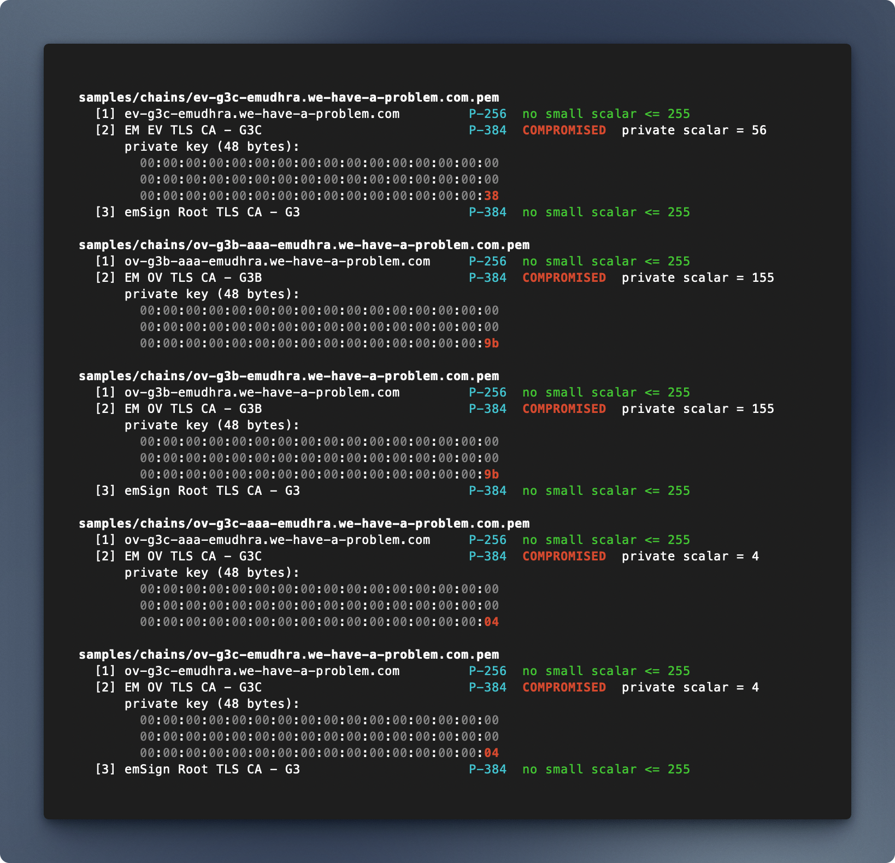

# Certificate Authority Keycheck

Checks and experiments with the of the [eMudhra intermediate CA key compromise](https://emudhra.we-have-a-problem.com/), ([archived](https://web.archive.org/web/20261020211414/https://emudhra.we-have-a-problem.com/)) disclosed on 2026-10-20

The disclosure says the private keys of eight eMudhra P-384 intermediates were generated incorrectly and can be recovered from the certificates alone. `check.pl` confirms this from public data: it computes `k*G` on P-384 for every `k` from 1 to 255 and compares each result to a certificate's public key. A match means the private key is `k`



### Reqs

- Perl 5 (core modules only: `Math::BigInt`, `IPC::Open2`)
- `openssl` on `PATH`


### Usage

After cloning this repo:

```sh
perl check.pl samples/chains/*.pem
```

- Every certificate in each file is checked
- P-384 and P-256 keys are supported, with the curve read from each certificate
- Other keys (RSA, other curves) are skipped
- On every run, a selftest first confirms that `G` and all of `1*G..255*G` lie on each curve


### Results

From `samples/chains`, the chains served by the disclosure's test hosts:

| Intermediate | Private scalar |
|---|---|
| EM DV TLS CA - G3B | 156 |
| EM DV TLS CA - G3C | 230 |
| EM EV TLS CA - G3B | 115 |
| EM EV TLS CA - G3C | 56 |
| EM OV TLS CA - G3B | 155 |
| EM OV TLS CA - G3C | 4 |

The Sectigo cross-signs (`*-aaa-*`) have the same keys and give the same results. The emSign Root TLS CA - G3 and the test hosts' P-256 leaf keys are not affected. The disclosure lists eight intermediates, and the other two aren't in these samples.

### Commit messages

Commits must use a conventional prefix, `.githooks/` rejects anything else.

Allowed types: `feat`, `fix`, `hotfix`, `refactor`, `style`, `chore`, `cleanup`, `perf`, `test`, `docs`, `content`
